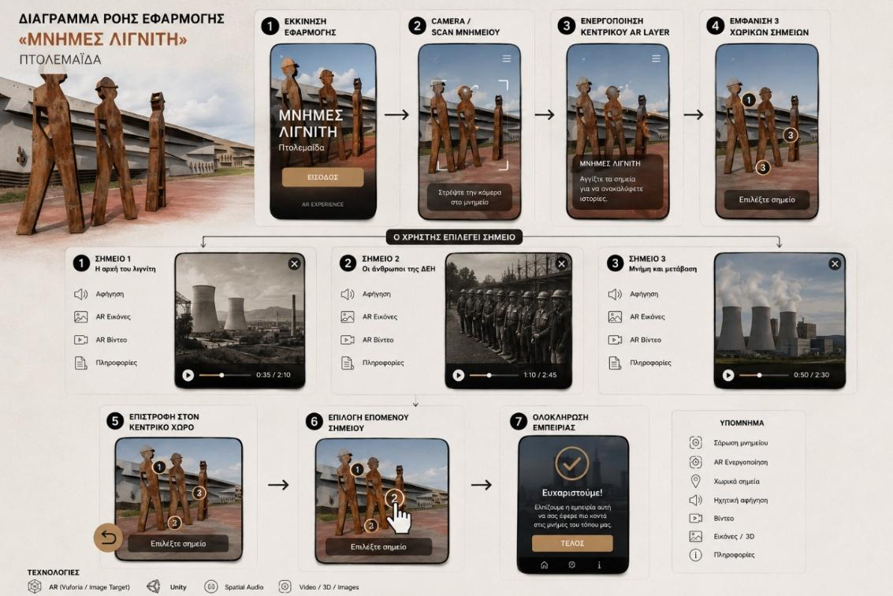
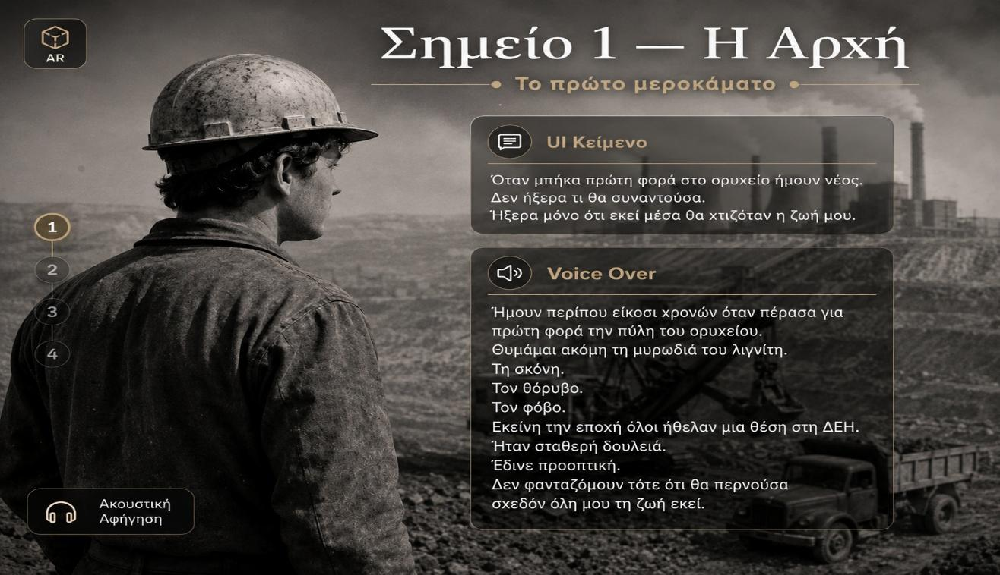
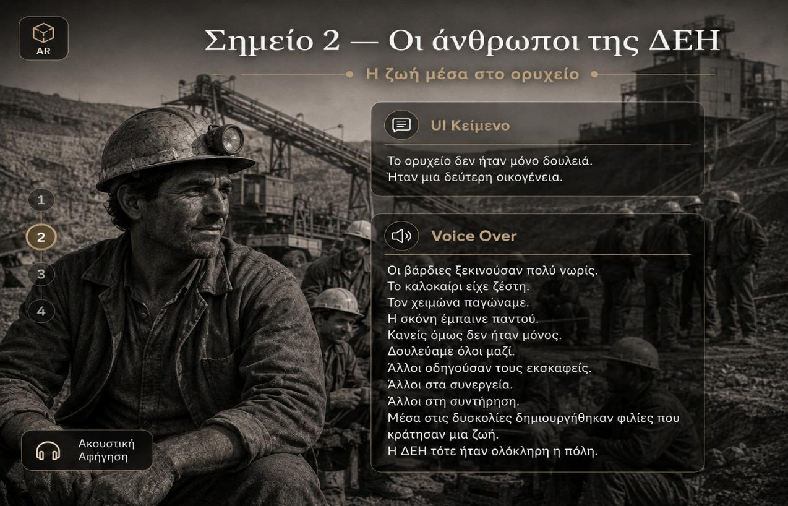
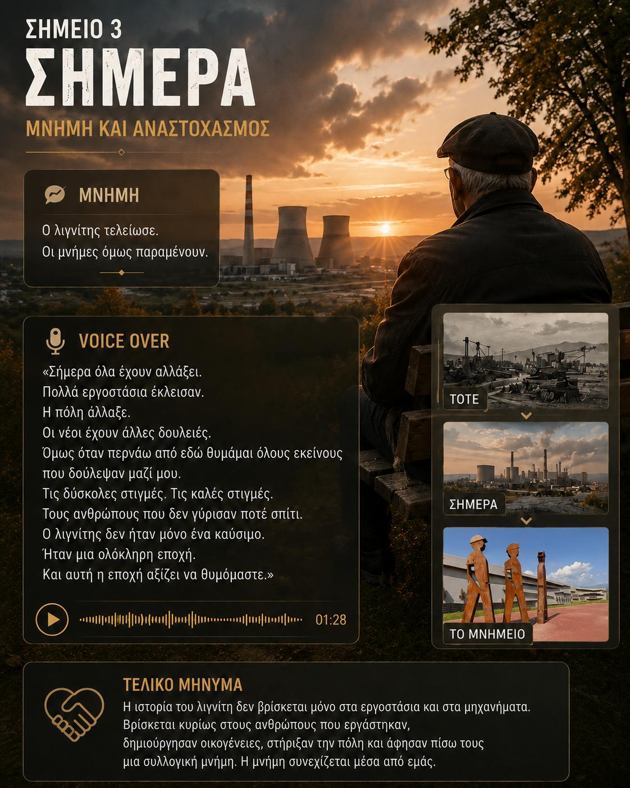

# Memories of Lignite — AR Cultural Heritage Experience

**Solo AR / Digital Heritage Project · Unity · C# · Vuforia · Mapbox**

[](https://www.youtube.com/watch?v=bCKneJ4cxJM)

▶ **[Watch the full AR application demo on YouTube](https://www.youtube.com/watch?v=bCKneJ4cxJM)**

## Overview

**Memories of Lignite** is a location-based augmented reality cultural experience designed around the public monument/park *Memories of Lignite* in Ptolemaida, Greece.

The project explores how AR can transform a static monument into an interactive carrier of local memory. Instead of functioning only as an informational guide, the experience combines image-target recognition, location/map interaction, voice narration, visual material, text, audio and video to guide the user through three moments in the social history of lignite mining and its workers.

The prototype was developed in **Unity / C#**, using **Vuforia** for the image-target workflow and **Mapbox** for map/location-oriented interaction.

## Experience Flow

The experience is structured as a short linear journey through three AR points:

### 1. The Beginning — The First Day of Work
Introduces a worker's first encounter with the mine: dust, noise, fear and the expectation of stable employment.

### 2. The People of DEI — Life in the Mine
Focuses on daily work, shifts, colleagues, difficulty, solidarity and the social world built around the mines.

### 3. Today — Memory and Reflection
Moves the narrative into the present, treating lignite not only as an energy resource but as an era, a lived experience and part of Ptolemaida's collective memory.

The core AR interaction is scanning an image target to activate the corresponding narrative point and its multimedia content.

## Implemented Technical Systems

### AR point / narration events
`POImanager.cs` contains separate event methods for each of the three AR points:

- Start the appropriate audio / voice-over when a tracked point appears.
- Stop playback when that tracked point is lost.
- Keep narration behavior separated per POI.

### Mapbox map controls
`MapPanZoomController.cs` implements custom interaction around Mapbox's `AbstractMap`:

- Mouse-wheel zoom
- Click-and-drag panning
- Mobile pinch-to-zoom
- Mobile one-finger panning
- Zoom limits
- Runtime map center / zoom updates

### POI proximity feedback
`Controller.cs` uses collider trigger events to provide POI feedback when the user enters or leaves selected POI areas, with delayed collider activation after startup.

### Video playback
`PlayVideo.cs` exposes a Unity-event-friendly method for starting playback through a `VideoPlayer` component.

## C# Architecture

| Script | Responsibility |
|---|---|
| `MapPanZoomController.cs` | Mapbox mouse/touch pan and zoom controls |
| `POImanager.cs` | AR-point appearance/loss audio behavior |
| `Controller.cs` | Trigger-based POI feedback and collider activation |
| `PlayVideo.cs` | Unity VideoPlayer playback |

**Stack:** Unity · C# · Vuforia · Mapbox SDK · Unity Physics / Colliders · AudioSource · VideoPlayer

See [`Documentation/Code_Architecture.md`](Documentation/Code_Architecture.md) for a more detailed breakdown.

## Interaction & Content Design

Each AR point combines multiple modalities:

- Short contextual UI text
- Voice-over narration
- Images / visual storytelling
- Environmental audio
- Video content
- Progress / interface cues
- Image-target scanning
- Map interaction

The voice narration is designed as oral-history-style testimony rather than neutral museum copy, giving the experience a more personal and memory-centered tone.

## UX / User Evaluation

A small-scale evaluation was carried out with **3 participants** who interacted with the basic three-point flow.

### Positive findings

- The three-part structure was easy to understand.
- The chronological and emotional progression was clear.
- Voice narration made the experience feel personal and testimonial.
- Short UI panels were perceived as helpful and guiding.

### Improvement opportunities

- Improve text/image readability in outdoor AR conditions.
- Improve voice-over volume and audio quality outdoors.
- Add replay controls for narration and complete AR points.
- Strengthen onboarding instructions for users less familiar with marker scanning.

## Design Challenges

The project surfaced several practical AR design challenges:

- Stable image-target recognition in Unity/Vuforia.
- Coordinating tracking events with voice/audio behavior.
- Deciding between screen-space UI and spatial AR presentation.
- Balancing historical information with personal testimony.
- Maintaining readability without visually overpowering the physical monument.
- Connecting digital content meaningfully to the physical location.

## Screenshots

### Application Flow


### AR Point 1 — The Beginning


### AR Point 2 — The People of DEI


### AR Point 3 — Memory and Reflection


## My Role

**Solo academic project.** I developed the concept, narrative structure, interaction flow, interface direction and AR prototype, combining cultural research with interactive-media design and Unity/C# implementation.

My work included:

- AR experience design
- Unity / C# prototyping
- Image-target interaction workflow
- Mapbox pan / zoom interaction
- POI trigger feedback
- Voice-over / AudioSource behavior
- VideoPlayer integration
- UI design and content hierarchy
- Narrative / spatial storytelling
- Small-scale user evaluation
- Iteration based on participant feedback

## What This Project Demonstrates

- Practical Unity and C# development in an AR context.
- Integration of AR, maps, audio, video and interface content.
- Designing an interactive digital product around a real cultural site.
- Applying augmented reality to cultural heritage and public memory.
- Working across technology, storytelling, UI and user experience.
- Translating oral-history / cultural material into an interactive experience.
- Evaluating a prototype with users and identifying concrete improvements.

## Future Improvements

- Refactor the POI logic into reusable / data-driven components.
- Add persistent visited/completed states for AR points.
- Add clearer onboarding and scanning guidance.
- Add accessible narration controls and replay behavior.
- Use more authentic archival photographs and documents.
- Include additional oral testimonies from former workers.
- Add more spatial AR / 3D content.
- Expand usability testing with a larger and more diverse participant group.

## Repository Structure

```text
Memories-of-Lignite-AR/
├── README.md
├── CREDITS.md
├── .gitignore
├── Scripts/
│   ├── Controller.cs
│   ├── MapPanZoomController.cs
│   ├── POImanager.cs
│   └── PlayVideo.cs
├── Screenshots/
│   ├── 01-application-flow.jpg
│   ├── 02-point-1-the-beginning.jpg
│   ├── 03-point-2-people-of-dei.jpg
│   └── 04-point-3-memory-and-reflection.jpg
└── Documentation/
    ├── Project_Summary.md
    ├── Technology_and_Interaction.md
    ├── Code_Architecture.md
    └── User_Evaluation.md
```

## Repository Scope

This repository is a portfolio presentation of the AR prototype. It contains the custom C# scripts, project screenshots and concise technical/design documentation. The complete Unity project and large third-party asset libraries are intentionally omitted.
